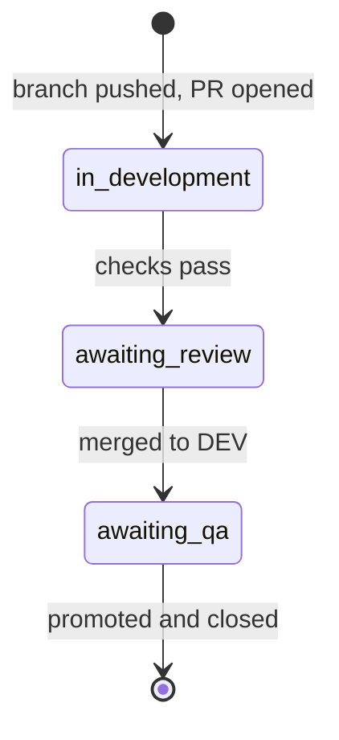

# Label conventions

Labels on this repository describe two things only: **where an issue is in the workflow** and **what kind of scrutiny it needs**. They are advisory metadata. The real controls are branch protection, required reviewers, and environment approvals - a label never authorizes a push, merge, or deployment.

## Rules

1. **One workflow label per issue.** An issue is in exactly one of `in development`, `awaiting-review`, or `awaiting-qa`. Remove the previous one when you add the next.
2. **Blockers are explicit.** `blocked`, `decision required`, and `human-only` mean the issue should not be picked up, and the reason must be in the body or a linked issue.
3. **Risk labels never grant permission.** They flag work that needs an explicit decision from the user before it runs.
4. **Do not invent area or type labels ad hoc.** Use the list below or extend this document first.

## Workflow



## Blockers

| Label | Meaning |
| --- | --- |
| `human-only` | Needs judgement, credentials, or access an agent should not use |
| `blocked` | Cannot proceed; the reason is in the body or a linked issue |
| `decision required` | Waiting on a product or technical decision |

`decision required` mirrors the `[Decision required]` title prefix used by the planner. When the decision is recorded, remove both the label and the prefix.

## Work state

| Label | Meaning |
| --- | --- |
| `in development` | A pull request is open for this issue |
| `awaiting-review` | The pull request is passing and waiting on user review |
| `awaiting-qa` | Merged to `DEV` and ready for QA promotion prep |

## Risk

| Label | Meaning | Extra requirement |
| --- | --- | --- |
| `breaking-change` | API contract or compatibility impact | Call it out in the PR summary |
| `data-change` | Migration, reset, or destructive data work | Explicit user approval before running |
| `security` | Auth, secrets, or permission changes | Extra review before merge |

## Size and priority

| Label | Meaning |
| --- | --- |
| `size: s` | Half a day or less |
| `size: m` | One to two days |
| `size: l` | Larger than two days - split before pickup |
| `priority: high` | Do next |
| `priority: normal` | Default ordering |

Size and priority are planning hints. They do not affect workflow state and are removed when an issue closes.

## Area

| Label | Applies to |
| --- | --- |
| `area: api` | Endpoints, contracts, validation |
| `area: data` | MySQL schema, migrations, persistence |
| `area: auth` | Authentication and identity |
| `area: infra` | CI, configuration, and deployment |

An issue may carry more than one area label. Keep the set small; add a new area only when a second issue needs it.

## GitHub defaults kept as-is

`bug`, `enhancement`, `documentation`, `accessibility`, `good first issue`, `help wanted`, `question`, `duplicate`, `invalid`, `wontfix`.

Do not add `type:` prefixed duplicates of these.

## Maintenance

- Keep the total under about 25 labels.
- Delete any label unused for 30 days.
- Update this document in the same pull request that adds or renames a label.

```powershell
# List labels
gh label list --repo Azeem-Brown/Household-Finances-Backend

# Create or update a label (safe to re-run)
gh label create "size: s" --repo Azeem-Brown/Household-Finances-Backend --color C5DEF5 --description "Half a day or less" --force
```
